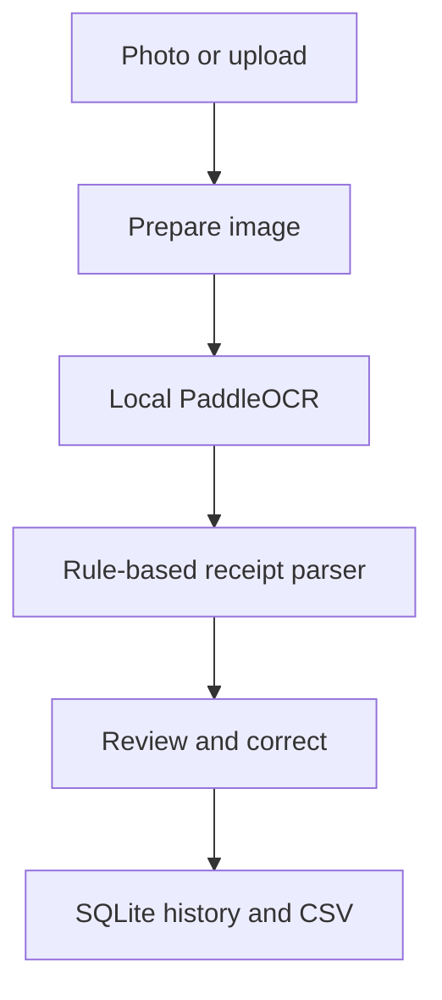

# TalliUpper

Optional pilot: [Local AI second opinion setup and evaluation](docs/LOCAL_AI_EXPERIMENT.md).
It compares source-backed item suggestions from a locally installed model with
the normal parser. You can add a suggested row to the review table; nothing is
saved until you review and save the receipt as usual.

Beta testers: start with the [Beta 0.1 release notes](docs/RELEASE_NOTES_0.1.md)
(known limitations and how to report a misread receipt).

**Every purchase, understood and owned by you.**

Created by Vincent, founder of 210 Imagination Works LLC.

TalliUpper is a local-first Python app that turns a receipt photo into reviewed,
searchable spending data. It recognizes the store, date, purchased items,
quantities, prices, discounts, subtotal, tax, and total—then lets a person correct
the result, categorize each item, and save it.

Local OCR is the default. Receipt images stay on the computer running the app; an
OpenAI vision mode is available only as an explicit optional fallback.

## Mission

TalliUpper's mission is to make understanding everyday spending approachable,
lively, and trustworthy—while keeping people in control of their receipts and
data.

Talli is more than decoration: her reactions communicate meaningful moments such
as working, success, uncertainty, and duplicate review. That warmth makes a
normally tedious task more encouraging without distracting from accurate,
professional financial records.

## Why this project exists

A receipt reader is not one step. It is a small document-processing pipeline:



TalliUpper keeps those stages independent, so OCR mistakes and parsing mistakes
can be diagnosed separately. The app also exposes each parser decision in plain
language—a useful way to learn how extraction systems work.

## Features

Duplicate protection blocks a second save of the same image or selected PDF page.
Matching store (ignoring case and extra spaces), date, currency, and total triggers
a possible-duplicate warning, including for manual entries or different photos.
Confirm that it is a separate purchase to save another record. Missing store/date
details cannot support this comparison. Existing duplicate records are retained.

- browser camera capture or JPG, PNG, WebP, HEIC, HEIF, and PDF upload;
- ordered multi-image local scans for long receipts that require several photos;
- editable UPC/SKU product codes when printed beside an item;
- CPU-based local OCR with PaddleOCR (PP-OCR) models;
- transparent Python rules for merchants, dates, items, quantities, prices,
  discounts, subtotal, tax, and total;
- editable human-review screen with arithmetic warnings;
- item-level expense categories, including Uncategorized and reusable custom
  categories;
- local SQLite history with itemized, receipt-summary, and beta personal-finance
  CSV exports;
- extraction-method tracking (`local-paddleocr`, `openai-vision`, or `manual`);
- synthetic receipt and expected output for safe demonstrations;
- unit tests plus GitHub Actions CI for Python 3.11 and 3.12;
- optional OpenAI vision fallback for difficult layouts.

When one receipt needs several photos, select all of them in top-to-bottom order. TalliUpper previews every selected image and local OCR reads them as one document. Do not combine images from separate purchases in one scan. Multi-image cloud vision is intentionally disabled for now.

PDF uploads are rendered locally for OCR. For a multi-page PDF, choose the page
to preview, read, review, and save; each page is handled separately. Password-
protected or unreadable PDFs display an error. The saved source name includes
the selected page. Restart the Windows launcher after updating to install the
PDF rendering dependency.

## Quick start on Windows

1. Open PowerShell and install Python 3.12. It can remain installed alongside
   another Python version:

   ```powershell
   winget install --id Python.Python.3.12 --exact --source winget
   ```

2. Close and reopen PowerShell, then confirm the compatible version is available:

   ```powershell
   py -3.12 --version
   ```

3. Get the code. Either:
   - on the GitHub page, choose **Code → Download ZIP** and extract it (the
     folder will be named `talliupper-beta-main`), or
   - clone it with Git (this makes a folder named `talliupper-beta`):

     ```powershell
     git clone https://github.com/vcampos2017/talliupper-beta.git
     ```

   Either folder works. Keep it somewhere easy to find, such as your user folder.
4. Open that folder and double-click `start_receipt_lens.bat`. If Windows shows
   "Windows protected your PC", choose **More info → Run anyway**.
5. Wait while the private Python environment and OCR packages are installed.
   This takes about 5 to 10 minutes the first time and only happens once.
6. If Windows Defender Firewall asks whether Python may communicate on networks,
   allow **Private networks** only. That is needed only if you want to open
   TalliUpper from a phone; choosing Cancel still works on this computer.
7. When the browser opens (at http://localhost:8501), choose **Try included
   sample** and select **Read receipt**. The first read takes about 1 to 2
   minutes while the OCR model files download (see below); later reads take
   seconds.

### Stop, restart, and update

- **Stop:** close the black launcher window, or click in it and press Ctrl+C.
  If it stays on "Stopping...", just close the window.
- **Start again:** double-click `start_receipt_lens.bat`. It reuses the
  environment it already built, so it starts in a few seconds.
- **Update:** stop TalliUpper first, get the new code (download the ZIP again,
  or run `git pull` in the folder), then start it again. Updating while it is
  running can show errors until you restart.
- **Only run one copy.** If TalliUpper is already running on port 8501, the
  launcher says so and does not start a second copy. Open
  http://localhost:8501 to use the running one, or close its window first to
  restart it.

### Open it from a phone

Your phone must be on the same Wi-Fi network as the computer. When TalliUpper
starts, the launcher window prints a **Network URL** such as
`http://192.168.1.25:8501`. Type that address into the phone's browser. If it
does not load, check that the firewall prompt in step 6 was allowed for private
networks.

The launcher explicitly selects Python 3.12, with Python 3.11 as a fallback. It
will not use an incompatible newer interpreter such as Python 3.14. If it detects
an incomplete or incompatible project environment, it asks before deleting and
rebuilding only the local `.venv` folder.

The first local scan also downloads PaddleOCR's model files (about 80 MB) and
therefore needs an internet connection. The app shows no download progress, so
wait 1 to 2 minutes rather than refreshing. The files are saved in
`C:\Users\<you>\.paddlex\official_models`. Once they are cached, later local
scans can run without uploading receipt images.

## Start from a terminal

Clone the project:

```bash
git clone https://github.com/vcampos2017/talliupper-beta.git
cd talliupper-beta
```

On Windows PowerShell, explicitly create the environment with Python 3.12 and
install everything, including local OCR and the optional cloud fallback:

```powershell
py -3.12 -m venv .venv
.\.venv\Scripts\python.exe -m pip install --upgrade pip
.\.venv\Scripts\python.exe -m pip install -r .\requirements.txt
.\.venv\Scripts\python.exe -m streamlit run .\app.py
```

On macOS or Linux:

```bash
python3 -m venv .venv
source .venv/bin/activate
python -m pip install --upgrade pip
python -m pip install -r requirements.txt
python -m streamlit run app.py
```

To run a second copy next to one that is already running (for example, a test
install), give it its own port:

```powershell
.\.venv\Scripts\python.exe -m streamlit run .\app.py --server.port 8599
```

For local-only use, install `requirements-local.txt`. For a smaller cloud-only
environment, install `requirements-cloud.txt`.

## Try the included sample

Choose **Try included sample** in the app, or upload
`sample_data/sample_receipt.png`. Its intended structured result is in
`sample_data/expected_receipt.json`. The image is generated entirely in code and
contains no real purchase data.

Recreate it at any time:

```bash
python scripts/generate_sample_receipt.py
```

## How the code is organized

| Path | Responsibility |
|---|---|
| `app.py` | Streamlit camera/upload, review, history, and learning UI |
| `receipt_reader/image_utils.py` | Image rotation, resizing, and JPEG conversion |
| `receipt_reader/local_ocr.py` | Lazy local PaddleOCR engine and result adapter |
| `receipt_reader/parser.py` | Readable rules that turn OCR lines into receipt fields |
| `receipt_reader/models.py` | Validated receipt and item models |
| `receipt_reader/database.py` | SQLite persistence, migration, and CSV export |
| `receipt_reader/extractor.py` | Optional cloud vision fallback |
| `tests/` | Parser, OCR-adapter, model, image, database, and app smoke tests |

See [the architecture guide](docs/ARCHITECTURE.md) for the stage boundaries and
[the learning guide](docs/LEARNING_GUIDE.md) for small hands-on exercises. When
you are ready to publish it, follow [the GitHub setup guide](docs/GITHUB_SETUP.md).

## Run the tests

The automated suite uses representative OCR payloads and receipt text; it does
not download Paddle models or call a paid API.

```bash
python -m pip install -r requirements-dev.txt
python -m pytest -q
```

### Score the receipt library

Real receipts that were once misread live in `tests/receipt_library/` with
their correct readings. To see how the parser does across all of them:

```bash
python scripts/score_receipts.py --details
```

To add a receipt, see [the receipt library guide](tests/receipt_library/README.md).
[How TalliUpper reads receipts](docs/RECEIPT_STANDARD.md) explains the standard
parser and merchant profiles; [the beta 0.1 plan](docs/BETA_0.1_PLAN.md) lists
the receipt-reading work before release.

### Run the Playwright browser test

The browser test starts TalliUpper against a separate `.playwright-data` database,
loads a synthetic receipt, deletes an unwanted zero-dollar row through the real
Streamlit interface, reloads the page to prove the deletion persisted, and checks
that the saved-receipt PDF can still be downloaded. It never opens or modifies the
normal `data/receipts.db` file.

Install Node.js 22 or newer, then run:

```bash
npm install
npx playwright install chromium
npm run test:e2e
```

To watch the browser while practicing locally:

```bash
npm run test:e2e:headed
```

GitHub Actions runs this focused Chromium test for pull requests and changes to
`main`. Failed runs retain the Playwright HTML report for troubleshooting.

## Privacy and data

| Mode | What leaves the computer? | API key required? |
|---|---|---|
| Local OCR | No receipt image is uploaded by TalliUpper | No |
| Manual entry | Nothing | No |
| OpenAI vision | The prepared receipt image is sent for extraction | Yes |

The beta personal-finance export follows Quicken Simplifi's published custom CSV
columns and creates one expense transaction per receipt. Single-category receipts
use that category; mixed receipts use **Mixed purchase** and include category totals
in Notes. This is automated schema compatibility, not certification from a live
paid Quicken import.

Corrected fields are stored in `data/receipts.db`. Receipt images and API keys are
not stored by the app. The `data/` directory, `.env`, and virtual environments are
excluded from Git. Avoid committing real receipts or personal purchase data.

## Current limitations

- Generic receipt rules cannot cover every retailer or layout.
- Currency currently defaults to USD in the local parser.
- Local date rules favor ISO and US-style dates.
- Faded thermal paper, glare, skew, and multi-column receipts can reduce accuracy.
- Discounts are currently associated with the preceding item.
- Every result should be reviewed before use for accounting, reimbursement, or tax
  records.

Saved item categories are remembered for future scans, including recovered OCR items.
Matching ignores capitalization and extra spaces while keeping product codes distinct.
You can change any suggested category before saving. **Pet food** is included in the
built-in categories, and existing saved category choices are picked up automatically.

## Roadmap ideas

Merchant names can be reused under **Store, date, and currency** while reviewing a
receipt. Use **Saved receipts → Edit merchant** to correct a saved merchant or add
a location/store number to its name. This changes only the selected receipt.

- add receipt-specific fixtures and accuracy metrics;
- support more currencies and locale-aware dates;
- extend OCR row reconstruction for multi-column layouts;
- add duplicate-receipt detection and category suggestions;
- package a desktop version with a local webview;
- learn store-specific aliases from human corrections.

## Technical references

- [PaddleOCR Python pipeline documentation](https://www.paddleocr.ai/main/en/version3.x/pipeline_usage/OCR.html)
- [PaddleOCR installation guide](https://www.paddleocr.ai/main/en/version3.x/installation.html)
- [Streamlit documentation](https://docs.streamlit.io/)

## License

Free for personal and household, noncommercial use under the
[TalliUpper Personal Use License](LICENSE). This is proprietary software,
not an open-source license. Business use, redistribution, resale, and hosted
services require written permission. Your financial data and exported reports
remain yours to use and share.

Versions through commit `064530d` were released under MIT; those permissions
remain in effect for that material. See [the preserved MIT license](LICENSE-MIT-LEGACY).
Third-party dependencies retain their own licenses.
